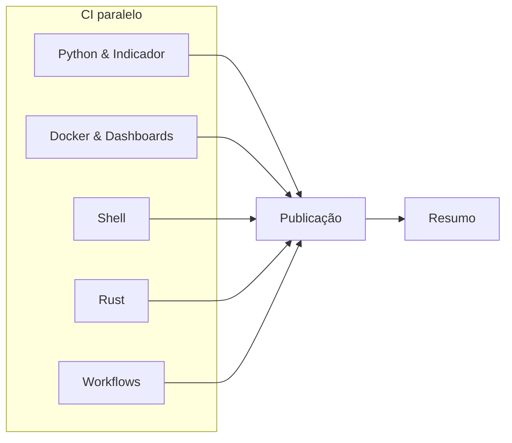

# GitHub Actions

CI por stack real do Aether (Python, Docker, Shell, Rust e Workflows). O indicador publico esta totalmente integrado nos jobs de Python (lint, seguranca e testes com cobertura 100%) e Docker (validacao de Compose e dashboards). JSON e YAML nao sao stacks: validam-se em steps `Python | JSON *` e `Python | YAML *`. Actionlint vive em `CI - Workflows`. CD = semantic-release apos CI verde.

## Visao (push em `main`)



| Fase | Job | Steps (formato `Area \| Stage`) |
|------|-----|----------------------------------|
| CI | Python | Lint (app e indicador), JSON/YAML, Validate, Seguranca (app e indicador), Testes (app e indicador 100%), Build |
| CI | Docker | Lint, Validate, Compose e Dashboards do Indicador, Seguranca, Testes, Build |
| CI | Shell | Lint, Validate, Seguranca, Testes, Build |
| CI | Rust | Lint, Validate, Seguranca, Testes, Build |
| CI | Workflows | Lint (actionlint) |
| Publicação | Publicação | Tags, Semantic (+ Baseline/Status) |
| Resumo | Resumo | Pipeline |

Crash-first em cada stack: lint, validate, security, test, build. Jobs por tecnologia; cada stage e um step unico (sem `strategy.matrix`).

## Workflows

| Workflow | Gatilho | Uso |
|----------|---------|-----|
| [ci.yml](ci.yml) | push/PR `main`, manual | CI por stack; release no push `main` |

## Composite actions

```text
.github/actions/
├── shared/pipeline-summary/
└── ci/
    ├── setup-python/
    ├── workflows/
    ├── release/
    └── sync-tags/
```

Na raiz, `make app-lint`, `make app-validate`, `make app-security`, `make app-test` e `make app-build` executam os respectivos estágios do `clean_workspace.py` para Python, configurações, Docker, Shell e Rust. Lint, segurança e testes também incluem o indicador, com cobertura de 100%. `app-lint` chama o Actionlint quando instalado; o job Workflows o exige no CI. `make app-pre-commit-run` executa a matriz completa de hooks, inclusive lint, segurança e testes do indicador.
