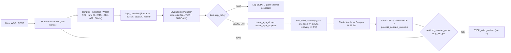

# Aether Quantum Engine

Motor autonomo de trading quantitativo na **Deriv** operando contratos **Rise/Fall de 5 minutos (`CALL`/`PUT`)** no indice sintetico **`R_10`** sobre velas **M5 fechadas (`300s`)**, com **100% da decisao binaria** delegada ao modelo **Laya System 1** (`convaiinnovations/laya`, `vegaml=False`), filtros `SKIP` configuraveis, gestao de capital **Kelly + Amortizacao por Payout (`kelly_recovery`)** e encerramento gracioso por **Stop-Win** isolado pelo lucro realizado da sessao.

---

## Fluxo de Decisao e Execucao Ponta a Ponta

---

## Arquitetura DDD & Hard Gates

O projeto segue **Domain-Driven Design (DDD)** e **Arquitetura Hexagonal (Ports & Adapters)** em **CPython 3.13 + asyncio**, verificados automaticamente pela suite [test_ddd_gates.py](tests/unit/architecture/test_ddd_gates.py):

- **Pureza de Dominio (`src/domain/`):** zero imports de infraestrutura, frameworks ML (`laya`, `torch`), bancos (`redis`, `asyncpg`) ou `pandas` (estritamente proibido; manipulacao colunar exclusivamente via **Polars**).
- **Portas & Adaptadores:** contratos `Protocol` em [`outbound.py`](src/application/ports/outbound.py) (`LayaDecisionPort`, `MarketCandlePort`, `SettlementQueuePort`) implementados pelos adaptadores em `src/infrastructure/`.
- **Hard Gate de Tamanho:** nenhum arquivo em `src/**/*.py` pode ultrapassar **300 linhas**.
- **Cobertura Obrigatoria:** **100.00%** de cobertura unitaria em `src/`, com **Ruff**, **Interrogate (100% docstrings)**, **Vulture** e **Cargo test** (extensao nativa Rust).

---

## Gestao de Capital (`kelly_recovery`) e Stop-Win

Implementada em [`kelly_recovery.py`](src/domain/risk/kelly_recovery.py) e configurada via SSOT em [`config/settings.json`](config/settings.json):

- **Kelly Fracionado:** `f = (b * p - (1 - p)) / b` com `fraction = 0.05` e teto exclusivo para entradas base `max_base_pct = 0.0125` (`1.25%` da banca), sem inflar probabilidades.
- **Piso Continuo:** minimo de **`1.00%` da banca** e **`$1.00`** mesmo quando Kelly for nulo ou negativo (`source=FLOOR`).
- **Recuperacao por Payout:** divida (`pending_loss`) reduzida apenas pelo lucro liquido realizado e amortizada em etapas ate o teto absoluto de **`5.00%` da banca** (`source=RECOVERY`), sem Martingale 2x ou progressao geometrica.
- **Stop-Win Realizado:** `stop_win_pct = 0.05` (`5%`), avaliado exclusivamente sobre `realized_session_pnl` (imune a creditos externos na conta Deriv) enquanto `orch.state.balance` sincroniza integralmente com o `balance_after` real da corretora.

---

## Comandos Principais (`Makefile` no WSL)

### Operacao Diaria

| Comando | Descricao |
| --- | --- |
| `make docker-up` | Sobe a stack de infraestrutura (`TimescaleDB`, `Redis`, `MinIO`, `Prometheus`, `Grafana`, `Tempo`) |
| `make app-run` | Verifica CUDA e inicia o motor continuo no `R_10` M5 com logs estruturados |
| `make docker-ps` / `make docker-logs` | Inspeciona o estado e os logs dos containers |

### Treinamento GPU (CUDA)

| Comando | Descricao |
| --- | --- |
| `make app-cuda-install` / `make app-cuda-check` | Instala PyTorch CUDA e valida inferencia na GPU sem enviar ordens |
| `make app-prepare` | Coleta e particiona 90 dias de velas `R_10` M5 (`60/10/10/20`) |
| `make app-train` | Executa fine-tuning e calibracao na GPU (`profile=auto`, `preset=fast` ou `complete`) |
| `make app-evaluate` / `make app-promote` | Compara candidato vs base no `test.jsonl` reservado e aprova checkpoint valido |

### Qualidade, Testes & CI/CD

| Comando | Descricao |
| --- | --- |
| `make app-lint` | Executa Ruff, Interrogate, Vulture, checagem JSON/YAML/Shell/Docker e Rust Clippy |
| `make app-validate` | Valida schemas JSON/YAML, scripts shell e compilacao Rust (`cargo check`) |
| `make app-test` | Executa toda a suite `pytest` com **100% de cobertura obrigatoria** + `cargo test` |
| `make app-pre-commit-run` | Roda todos os hooks de qualidade e seguranca do repositorio |
| `make app-commit ARGS="-m '...'"` | Cria commit no padrao Conventional Commits em PT-BR |

---

## Documentacao Tecnica

- **Indice Central:** [`docs/README.md`](docs/README.md)
- **Guia de Agentes & Regras Globais:** [`AGENTS.md`](AGENTS.md)
- **Arquitetura DDD & Hexagonal:** [`docs/arquitetura.md`](docs/arquitetura.md)
- **Estrategia Laya System 1:** [`docs/strategy-laya.md`](docs/strategy-laya.md)
- **Treinamento GPU & Promocao:** [`docs/laya-training.md`](docs/laya-training.md)
- **Orquestrador & Ciclo M5:** [`docs/engineering-orchestrator.md`](docs/engineering-orchestrator.md)
- **Configuracoes SSOT:** [`docs/engineering-settings-ssot.md`](docs/engineering-settings-ssot.md)
