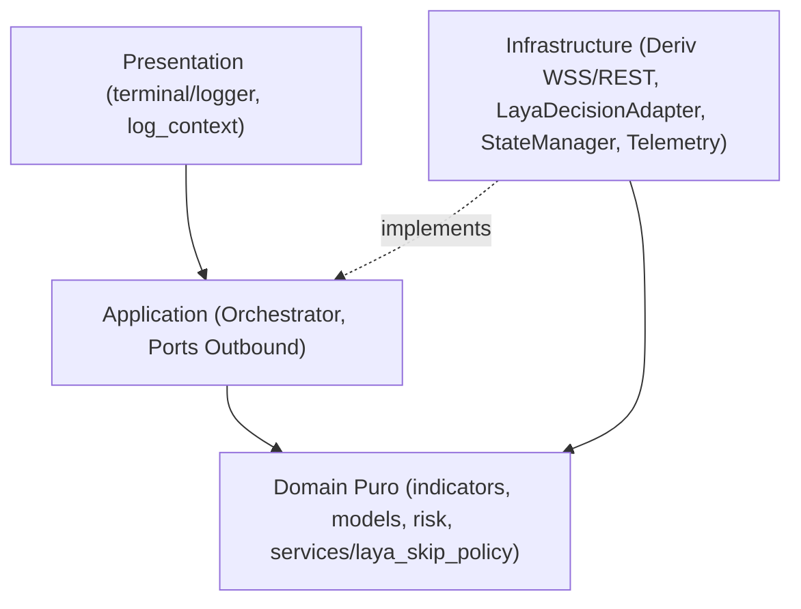

# Arquitetura do Aether Quantum Engine (Laya Continuo R_10 M5)

O motor segue **DDD (Domain-Driven Design)** e **Arquitetura Hexagonal (Ports & Adapters)** em **Python 3.13** com **asyncio** no host e stack de dados/telemetria em Docker (`Redis`, `TimescaleDB`, `MinIO`, `Prometheus`, `Grafana`, `Tempo`).

## Camadas DDD

- **Domain (`src/domain/`)**: 100% puro, sem imports de infraestrutura, frameworks ou `pandas` (validado automaticamente por `tests/unit/architecture/test_ddd_gates.py`).
  - `indicators/`: calculo causal de todos os indicadores tecnicos (`compute_indicators`, `IndicatorSnapshot`, Wilder RSI, Hurst 50).
  - `models/`: `Candle`, `TradeDirection`, `Contract`, `LayaDecision` (estritamente `CALL` ou `PUT`).
  - `risk/`: `RiskManager`, `StakeSizing` e `size_kelly_recovery` (Kelly fracionado com teto base configuravel, piso de 1%, recuperacao por payout e teto absoluto de 5%).
  - `services/`: `laya_skip_policy.py` (`evaluate_laya_skip` configuravel via `laya.skip_policy`).
- **Application (`src/application/`)**:
  - `ports/outbound.py`: contratos `Protocol` (`MarketCandlePort`, `SettlementQueuePort`, `LayaDecisionPort`).
  - `services/orchestrator/`: ciclo M5 continuo no `R_10`, warmup de velas fechadas, avaliacao de `SKIP` antes de cotar proposta, log obrigatorio `INDICATORS | ...` e `LAYA_DECISION | ...`, envio de ordens Rise/Fall 5m e reconciliacao de liquidacao.
- **Infrastructure (`src/infrastructure/`)**:
  - `inference/`: `laya_decision_adapter.py` (adapter de `LayaDecisionPort` usando `laya==0.5.5`, `vegaml=False` e passadas simetricas), `laya_narrative.py` (narrativa tecnica em 3 estados), `laya_context.py` (orcamento exato sem truncamento) e `laya_checkpoint.py`.
  - `api/` e `handlers/`: WebSocket/REST Deriv, stream M5 (`R_10`), buffer de ticks, cotacao/revalidacao de proposta (`laya_quote_sizing.py`) com sincronia de saldo real.
  - `state/`, `market/`, `telemetry/`: `StateManager` (Stop-Win isolado por `realized_session_pnl`), Redis ZSET para liquidacao, TimescaleDB para contratos/velas e Prometheus/OTel (`prometheus_business_format.py`).
- **Presentation (`src/presentation/`)**: logging estruturado em terminal e arquivo sem emojis.
- **Tools (`tools/laya_workflow/`)**: pipeline offline GPU (`prepare`, `train`, `evaluate`, `promote`) e checagem CUDA (`tools/laya_cuda_check.py`).
