# Arquitetura — Aether Quantum Engine

O Aether executa contratos Rise/Fall de cinco minutos para índices sintéticos de ações mundiais OTC (réplicas de ETFs) e Volatility da Deriv. O motor Python 3.13.12 roda no host com `asyncio`; os serviços Redis, TimescaleDB, MinIO, Prometheus, Grafana e os pipelines ML rodam em Docker. A rota de execução é governada soberanamente pelo setup institucional sênior (`senior_institutional`) com 5 pilares de confluência (EMA, ATR, Session VWAP, FVG e Hard Gate de Killzones no Horário de Brasília). Consulte [a arquitetura sênior](engineering-architecture-senior.md) para os limites entre camadas.

## Relógios e dados

| Superfície | Configuração atual |
|---|---|
| Ciclo e assinatura | 300 s, alinhados à fronteira M5 |
| Micro e MINI | 300 s; histórico de treino de 25.000 velas M5 |
| Macro | 86.400 s; contexto diário D1 |
| TCN | 14 features, lookback 32, tensor `[1, 32, 14]` |
| Label | `spot_forward`, horizonte de uma vela M5 |
| Contrato | `RISE_FALL`, duração de 5 minutos |

O label usa closes futuros para treinar direção. Ele não é o spot executado nem uma liquidação confirmada pelo broker. A calibração fornece `P(CALL)`; o lado inicial é CALL quando a probabilidade calibrada é pelo menos 0,5 e PUT nos demais casos. O loss-classifier pode aplicar FLIP após aprendizado. Os quatro vetos de mercado e os bloqueios técnicos e econômicos são avaliados antes da compra.

## Fluxo

```mermaid
flowchart LR
    WS[WebSocket Deriv] --> Buffer[Velas e ticks]
    Buffer --> Cycle[Ciclo M5]
    Cycle --> TCN[TCN local]
    TCN --> Direction[Direção e filtros]
    Direction --> Risk[Kelly e recuperação]
    Risk --> Quote[Proposta e cotação]
    Quote --> Contract[Contrato]
    Contract --> Settle[Liquidação e reconciliação]
    Settle --> State[Redis e Timescale]
```

O treinamento separado grava um checkpoint TCN local. O verificador pós-treino exige pesos, normalização e geometria compatíveis com `settings.json`: dimensão de features, lookback, granularidade, label e horizonte. A execução não usa qualificação estatística da TCN nem simulação de liquidação por closes M5. DEMO e REAL seguem o mesmo caminho de decisão. Um checkpoint incompatível bloqueia a operação; com checkpoint válido, a stake inicial fica limitada a **1% da banca por ordem**, inclusive na recuperação `cover_l0`.

O meta LightGBM e o loss-classifier aprendem em sidecars. A TCN roda no host e não faz retreino durante a operação (`online_training=false`). A publicação de métricas e a captura Timescale não autorizam ordens; a proposta final é validada pelo payout e pelo edge calculado para o lado escolhido.

## Risco e estado

O estado de sessão e a fila de liquidação usam Redis; a fila prioritária é a ZSET `settlement:queue:priority`. Timescale guarda observações de mercado e contratos; MinIO guarda artefatos aplicáveis dos serviços. Kelly fracionário usa referência de payout 0,85 e stop win por sessão de 4,31%. A política não define stop loss nem teto acumulado de perda. Limites por ordem, bloqueios de execução e reconciliação de contratos continuam ativos.

## Referências

- [Configuração e resolvers](engineering-settings-ssot.md)
- [Treino TCN](engineering-deep-learning.md)
- [Orquestrador](engineering-orchestrator.md)
- [Liquidação](engineering-settlement.md)
- [Infraestrutura](infra-docker.md)

## Consenso com o indicador público

O subsistema [`indicator/`](../indicator/README.md) usa apenas dados públicos e roda no mesmo Compose, TimescaleDB, Prometheus e Grafana do motor; tabelas de sinais e contratos permanecem distintas. Na abertura de M5/M15/H1, o motor consulta a versão em piloto na DEMO ou ativa na REAL e exige a última vela fechada, probabilidade válida e lado CALL/PUT. M5 mantém checkpoint TCN técnico, mas o indicador aprovado determina o lado mesmo quando a TCN diverge. M15/H1 usam modelo próprio do indicador. Cada contrato dura 5, 15 ou 60 minutos; somente os primeiros 30 segundos da vela permitem entrada. A stake REAL não excede 1% da banca disponível e a cotação exige EV positivo com margem sobre o break-even, inclusive em recuperação. Sem preço, payout, saldo, modelo ou evidência de 200 liquidações DEMO confirmatórias, REAL não compra. O motor não usa o fechamento observado como resultado de opção; a auditoria de contrato usa apenas a liquidação confirmada pela Deriv.

OTC_SX5E e a ancora operacional promovida atual (Euro Stoxx 50 / FEZ). O treino abrange o catalogo completo de 12 ativos mundiais OTC integrados a cotacoes reais de mercado via Yahoo Finance HTTP v8. Se a Deriv rejeitar explicitamente o ID da proposta de um sinal aprovado, uma unica tentativa de compra por parametros usa o mesmo WSS, a mesma vela M5 e preco maximo limitado a stake.

Uma falha isolada de ativo não cancela inferências dos demais. A seleção pode devolver vários índices no mesmo ciclo. O envio é serial para reservar saldo sem corrida entre propostas; as liquidações seguem assíncronas e os contratos de índices distintos podem coexistir. Em recuperação, uma ordem por ciclo. O resultado por versões da TCN e do indicador está em `contract_consensus_outcomes`.
