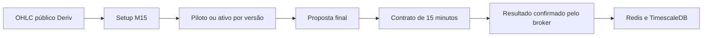

# Arquitetura — Aether Quantum Engine

O Aether executa contratos Rise/Fall de 15 minutos por sinal institucional M15 da Deriv. O motor Python roda no host com `asyncio`; Redis, TimescaleDB, indicador público, Prometheus e Grafana compartilham o Compose. TCN e ML legados ficam em pesquisa separada. Consulte [o setup operacional](strategy-pullback.md).

## Relógios e dados

| Superfície | Configuração atual |
|---|---|
| Indicador operacional | M15, 128 velas fechadas da Deriv |
| Entrada | Até 60 segundos após abertura da vela seguinte |
| Contrato | Rise/Fall, 15 minutos |
| Pesquisa | H1, D1 e stream M5 legado; sem autoridade de compra |

O motor seleciona apenas sinal M15 da versão configurada. A DEMO usa piloto versionado; a REAL exige 200 liquidações DEMO do broker, limite inferior positivo e cotação final com EV positivo e margem. O lado do setup não é invertido pelo stream. Sem sinal atual, a execução fica vazia.

## Fluxo

O histórico de pesquisa é proxy de velas, separado do resultado de contrato. A referência de preço da sessão usa preços típicos OHLC sem volume, com bandas de 1,5 desvio padrão. Não é VWAP por volume. As séries externas não são concatenadas às velas da Deriv.

## Risco e estado

O estado e a fila de liquidação usam Redis; Timescale guarda sinais e contratos. Stake base de 1% da banca disponível e recuperação pelo payout cotado limitada a 5% por ordem. Não há stop loss nem teto acumulado de perda. Reserva por conta, ativo e vela, reconciliação de compra sem ACK e deduplicação por contrato continuam ativas.

## Referências

- [Configuração e resolvers](engineering-settings-ssot.md)
- [Treino TCN](engineering-deep-learning.md)
- [Orquestrador](engineering-orchestrator.md)
- [Liquidação](engineering-settlement.md)
- [Infraestrutura](infra-docker.md)

## Indicador público e motor

O indicador público não autentica conta nem compra contratos. O motor consulta seu sinal M15 da última vela fechada e da versão vigente. A âncora operacional configurada é `OTC_SSMI`; o treino não troca essa âncora. Ativos e períodos diferentes permanecem separados por identidade no banco e na auditoria.
